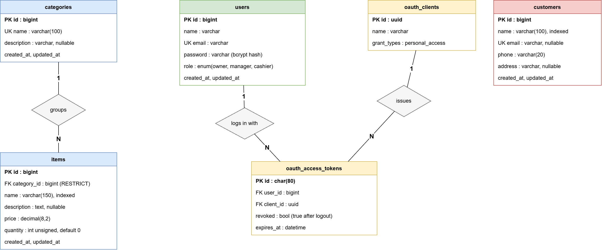

# Ice Cream Shop API

A REST API built with Laravel for managing an ice cream shop's inventory and customer records. It includes token-based authentication and role-based permissions for Owners, Managers and Cashiers.

## Tech Stack

- Laravel 13
- PHP 8.3
- MySQL 8
- Laravel Passport 13
- PHPUnit

## Features

- Login and logout using Laravel Passport access tokens
- Create, view, update and delete inventory items
- Manage customer records
- Search items and customers with pagination
- Role-based permissions for Owners, Managers and Cashiers
- Request validation and consistent JSON error responses
- Login rate limiting
- Database migrations, factories and seeders
- Automated tests for API endpoints and role permissions

## User Roles

Each role has different permissions depending on the resource.

| Action | Owner | Manager | Cashier |
|---|---|---|---|
| View items | Yes | Yes | Yes |
| Create items | Yes | Yes | No |
| Update items | Yes | Yes | Yes |
| Delete items | Yes | No | No |
| View customers | Yes | Yes | Yes |
| Create customers | Yes | Yes | Yes |
| Update customers | Yes | Yes | Yes |
| Delete customers | Yes | No | No |

Permissions are handled through Laravel Policies in `app/Policies/ItemPolicy.php` and `app/Policies/CustomerPolicy.php`.

## Requirements

- PHP 8.3 or later
- Composer 2
- MySQL 8
- Required PHP extensions: `pdo_mysql`, `openssl`, `mbstring`, `sodium` and `zip`

On Windows, you can use [Laragon](https://laragon.org/) to set up PHP, Composer and MySQL.

## Installation

Clone the repository and install the dependencies:

```bash
git clone https://github.com/shehan-03/IceCream-Shop-API.git
cd IceCream-Shop-API
composer install
```

Create your environment file:

```bash
cp .env.example .env
php artisan key:generate
```

On Windows Command Prompt, use `copy .env.example .env` instead of the `cp` command.

Create two MySQL databases:

```sql
CREATE DATABASE icecream_shop
    CHARACTER SET utf8mb4
    COLLATE utf8mb4_unicode_ci;

CREATE DATABASE icecream_shop_test
    CHARACTER SET utf8mb4
    COLLATE utf8mb4_unicode_ci;
```

Update the database settings in your `.env` file.

Run the migrations and seed the database:

```bash
php artisan migrate --seed
```

Set up Passport's encryption keys and personal access client:

```bash
php artisan passport:keys
php artisan passport:client --personal --provider=users --no-interaction
```

Start the development server:

```bash
php artisan serve
```

The API will be available at `http://127.0.0.1:8000`.

To reset the database, run:

```bash
php artisan migrate:fresh --seed
php artisan passport:client --personal --provider=users --no-interaction
```

The reset removes Passport's personal access client, so the second command is needed before you can log in again.

## Test Accounts

The database seeder creates the following accounts:

| Role | Email | Password |
|---|---|---|
| Owner | `owner@icecream.test` | `password` |
| Manager | `manager@icecream.test` | `password` |
| Cashier | `cashier@icecream.test` | `password` |

It also creates sample categories, inventory items and customers.

These credentials are for local development only.

## API Endpoints

All endpoints return JSON. Login is public; the other endpoints require a valid access token unless stated otherwise.

Include the following header in authenticated requests:

```http
Authorization: Bearer <token>
```

### Authentication

| Method | Endpoint | Description |
|---|---|---|
| POST | `/api/auth/login` | Log in and receive an access token |
| POST | `/api/auth/logout` | Revoke the current token |
| GET | `/api/auth/me` | Get the authenticated user's details |

### Categories

| Method | Endpoint | Description |
|---|---|---|
| GET | `/api/categories` | List available ice cream categories |

### Inventory Items

| Method | Endpoint | Description |
|---|---|---|
| GET | `/api/items` | List items with search and pagination |
| GET | `/api/items/{id}` | Get an item |
| POST | `/api/items` | Create an item |
| PUT/PATCH | `/api/items/{id}` | Update an item |
| DELETE | `/api/items/{id}` | Delete an item |

Use the `search`, `page` and `per_page` query parameters when listing items.

### Customers

| Method | Endpoint | Description |
|---|---|---|
| GET | `/api/customers` | List customers with search and pagination |
| GET | `/api/customers/{id}` | Get a customer |
| POST | `/api/customers` | Create a customer |
| PUT/PATCH | `/api/customers/{id}` | Update a customer |
| DELETE | `/api/customers/{id}` | Delete a customer |

Customer search supports name, email and phone.

### Example Request

Create an inventory item:

```http
POST /api/items
Authorization: Bearer <token>
Content-Type: application/json
```

```json
{
  "category_id": 1,
  "name": "Mint Chocolate Chip",
  "price": 480,
  "quantity": 20
}
```

The user must have permission to create inventory items.

## Postman

Import `postman/IceCreamShop.postman_collection.json` into Postman.

Start by running one of the login requests for the Owner, Manager or Cashier. The collection saves the returned token for subsequent requests.

## Running Tests

The project includes automated tests for authentication, inventory, customers and role permissions.

Run the tests with:

```bash
php artisan test
```

Tests use the separate `icecream_shop_test` database configured in `phpunit.xml`, keeping development data separate.

The test suite covers:

- Login, validation and token revocation
- Access without authentication
- Permissions for each role
- Inventory CRUD operations, search and pagination
- Customer CRUD operations and search
- Validation errors and missing records
- Policy logic

## Database Design



The diagram is in `docs/ER-diagram.png`. The editable source is `docs/ER-diagram.drawio` (open it at [draw.io](https://app.diagrams.net)).
